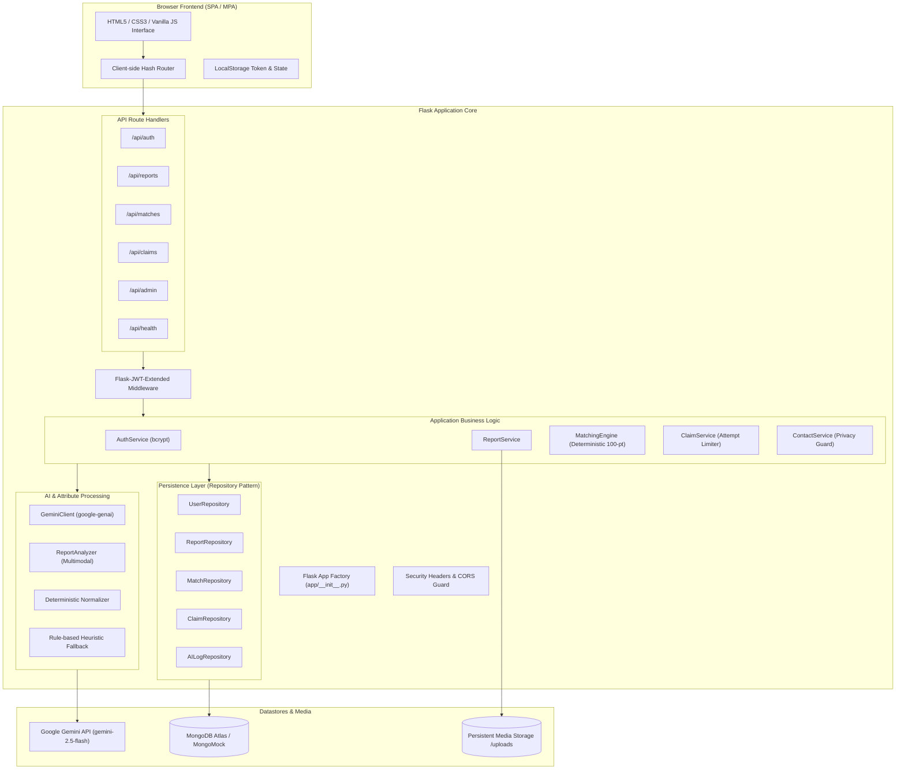

# SmartMatch — System Architecture & Technical Design

## 1. System Architecture Overview

SmartMatch is designed as a **Modular Monolith** adhering to strict separation of concerns between presentation, routing, application business logic, persistence, and external AI integrations.



---

## 2. Database Schema & Indexes

SmartMatch implements five core collections in the `smartmatch` database.

### 2.1 Collection: `users`
| Field | Type | Description |
|---|---|---|
| `_id` | ObjectId | Unique user identifier |
| `name` | String | Full user name |
| `email` | String | Case-insensitive unique institutional email |
| `password_hash` | String | Salted bcrypt hash |
| `role` | String | `student` or `admin` |
| `is_active` | Boolean | Account status |
| `created_at` | DateTime | Account creation timestamp |

**Indexes:**
- `{"email": 1}`, Unique: true
- `{"role": 1}`

### 2.2 Collection: `reports`
| Field | Type | Description |
|---|---|---|
| `_id` | ObjectId | Unique report identifier |
| `user_id` | ObjectId | Submitting user reference |
| `report_type` | String | `lost` or `found` |
| `title` | String | Item headline |
| `description` | String | User-provided text description |
| `category` | String | Canonical category (`electronics`, `personal_accessory`, etc.) |
| `location` | String | Campus incident location |
| `incident_date` | String | ISO formatted date (`YYYY-MM-DD`) |
| `image_path` | String | Relative URL path to uploaded photograph |
| `attributes` | Object | Normalized attribute dictionary (color, material, shape, brand, features) |
| `object_type` | String | Canonical object type (`wallet`, `water_bottle`, `backpack`, etc.) |
| `user_stated_details` | Array | Details explicitly mentioned in description text |
| `visually_observed_details` | Array | Details verified from photograph |
| `unknowns` | Array | Ambiguous, obscured, or undetermined attributes |
| `image_quality` | String | `high`, `adequate`, `poor`, `unreadable` |
| `ai_status` | String | `completed`, `failed`, `manual` |
| `extraction_version` | String | Schema extraction version |
| `status` | String | `active`, `claim_pending`, `under_review`, `resolved`, `inactive`, `closed` |
| `created_at` | DateTime | Timestamp |
| `updated_at` | DateTime | Timestamp |

**Indexes:**
- `{"report_type": 1}`
- `{"status": 1}`
- `{"user_id": 1}`
- `{"incident_date": -1}`
- `{"created_at": -1}`

### 2.3 Collection: `matches`
| Field | Type | Description |
|---|---|---|
| `_id` | ObjectId | Unique match pair record |
| `lost_report_id` | String | ID of lost report |
| `found_report_id` | String | ID of found report |
| `score` | Float | 0.0 to 100.0 deterministic score |
| `label` | String | `Strong candidate`, `Possible match`, `Low similarity` |
| `score_breakdown` | Object | Points allocated per attribute |
| `matched_attributes` | Array | Explanatory strings of matching characteristics |
| `conflicts` | Array | Explanatory strings of conflicting characteristics |
| `unknowns` | Array | Explanatory strings of neutral/missing characteristics |
| `algorithm_version`| String | Version string (e.g. `1.0.0`) |
| `config_version` | String | Config version string (e.g. `2026.1`) |
| `created_at` | DateTime | Timestamp |

**Indexes:**
- `{"lost_report_id": 1, "found_report_id": 1}`, Unique: true
- `{"score": -1}`

### 2.4 Collection: `claims`
| Field | Type | Description |
|---|---|---|
| `_id` | ObjectId | Unique claim identifier |
| `report_id` | String | Found item report reference |
| `claimant_id` | String | User ID of claimant |
| `verification_answers`| String | Private ownership evidence |
| `status` | String | `pending`, `approved`, `rejected`, `locked` |
| `attempt_count` | Integer | Counter (max 3 before lock) |
| `reviewed_by` | String | User ID of reviewing finder or admin |
| `reviewed_at` | DateTime | Review timestamp |
| `review_notes` | String | Optional notes |
| `created_at` | DateTime | Timestamp |

**Indexes:**
- `{"report_id": 1}`
- `{"claimant_id": 1}`
- `{"status": 1}`

### 2.5 Collection: `ai_logs`
| Field | Type | Description |
|---|---|---|
| `_id` | ObjectId | Unique audit record |
| `report_id` | String | Associated report ID |
| `model_name` | String | Gemini model string (`gemini-2.5-flash`) |
| `prompt_version` | String | Prompt template version |
| `extraction_version`| String | Schema version |
| `status` | String | `completed`, `failed`, `manual` |
| `error_type` | String | Exception class name if failed |
| `created_at` | DateTime | Timestamp |

---

## 3. Deterministic Matching Engine

The core product principle dictates that **Gemini must never decide final match rankings**. The matching algorithm is implemented in pure, predictable Python logic.

### 3.1 100-Point Scoring Matrix
| Attribute | Max Points | Evaluation Rules |
|---|---:|---|
| **Category** | 20 | Identical category: 20 pts. Generic 'other': 10 pts. Conflict: 0 pts. |
| **Object Type** | 15 | Identical object type: 15 pts. Partial/substring match: 10 pts. Generic 'item': 5.25 pts. Conflict: 0 pts. |
| **Brand / Logo** | 15 | Matching recognized brand: 15 pts. Both unbranded/unknown: 7.5 pts. Brand on one only: 7.5 pts. Distinct brands: 0 pts. |
| **Color** | 15 | Overlapping normalized colors: 15 pts. Both unknown: 7.5 pts. One unknown: 7.5 pts. Conflicting colors: 0 pts. |
| **Material & Shape**| 10 | Material overlap: 5 pts (unknown: 2.5 pts). Shape overlap: 5 pts (unknown: 2.5 pts). |
| **Distinctive Features**| 15 | Shared characteristic keywords (sticker, engraved, scratched, keychain, etc.): 15 pts. Neutral: 5-7.5 pts. |
| **Location Proximity**| 5 | Identical location text: 5 pts. Substring/zone overlap: 4 pts. Different campus zone: 2 pts. |
| **Date Proximity** | 5 | Same date: 5 pts. Within 2 days: 4.5 pts. Within 7 days: 3.5 pts. Within 14 days: 2 pts. >30 days: 0 pts. |
| **Total** | **100** | Clamped to range `[0.0, 100.0]`. |

### 3.2 Ranking Thresholds
- **Strong candidate:** Score $\ge 70.0$
- **Possible match:** $40.0 \le \text{Score} < 70.0$
- **Low similarity:** $\text{Score} < 40.0$

### 3.3 Deterministic Tie-Breaking Sequence
When reports have identical match scores, ordering is guaranteed deterministic by evaluating:
1. `score` descending.
2. `incident_date` proximity ascending (closest dates first).
3. `created_at` ascending.
4. Stable report `id` ascending.

---

## 4. Privacy & Contact Security Architecture

### 4.1 Contact Information Shield
- `GET /api/reports` and `GET /api/reports/<id>` never return e-mail addresses of other users
  (`submitter_email` is masked unless the requester is the submitter).
- Matches, claim lists and report responses contain no contact fields.

### 4.2 Authorized Handover Endpoint — `GET /api/reports/<id>/contact`
1. Valid JWT required (401 otherwise); found reports only.
2. Allowed: **the finder** of that found report, or **the claimant whose claim the finder approved**.
3. Everyone else, including administrators, receives `403` (design report 9.2: no admin bypass).
4. Returns finder (and, once approved, claimant) contact plus safe handover instructions.

### 4.3 Claim Verification (server-side)
- When creating a found report the finder may set a **private clue** (`verification_clue`, 3–300 chars).
  It is stored in the separate `verification_clues` collection and is never returned by any endpoint;
  the owner only sees `has_private_clue: true`.
- `POST /api/claims` compares the claimant's answer with the clue on the server
  (`app/services/verification_service.py`): lower-casing, punctuation removal, stop-word removal and fixed
  suffix stripping, then **verified if ≥ 60 %** (`CLAIM_VERIFICATION_THRESHOLD`) of the clue's keywords
  appear in the answer. Failures return a generic message with remaining attempts (400).
- `verification_status`: `verified` | `failed` | `not_required` (no clue set → finder reviews free text).
- Attempts are counted atomically (`find_one_and_update` with `attempt_count < MAX`). At 3 attempts without
  verification the claim is `locked`; further requests get **429**. A unique index on
  `(report_id, claimant_id)` stops a user opening a second claim to bypass the limit.
- The finder (or admin) sees only `verified` / `not_required` pending claims and can approve only those.
  Approval resolves the report and rejects competing pending claims. Reviews are atomic
  (`status: pending` precondition) so a claim cannot be decided twice (409).

## 5. Report Submission & AI Review Workflow

1. `POST /api/reports/analyze` (JWT, rate-limited): validates title, description and photo, runs Gemini on a
   temporary copy (deleted afterwards) and returns `{analysis_id, ai_status, suggestion}`. Nothing is saved.
2. The UI fills editable fields with the suggestions, clearly labelled *AI suggestions*, and shows
   user-stated vs visually observed details vs unknowns. If AI failed it shows *AI unavailable: manual entry*.
3. `POST /api/reports` (multipart) with `confirmed_attributes` (JSON), optional `analysis_id`, `ai_details`
   and `verification_clue`. The confirmed attributes are normalized and saved (`attribute_source:
   user_confirmed`). `ai_status` is taken from the linked `ai_logs` entry (each analysis can be linked only once),
   never from the client.
4. Without `confirmed_attributes` the server runs extraction itself with the same fallback
   (`attribute_source: ai | rule_based_fallback`).

Upload validation: missing photo → 400 `PHOTO_REQUIRED`; > 5 MB → 413 `FILE_TOO_LARGE`; wrong extension or
decoded format not JPEG/PNG/WebP, corrupt image or decompression bomb → 415. Dates must be within
`MIN_INCIDENT_DATE` (2020-01-01) … tomorrow.

## 6. Report Lifecycle

| Status | Set by | In search? | Match candidate? |
|---|---|---|---|
| `active` | backend on creation; claim rejected with no other pending claims | yes | yes |
| `claim_pending` | backend when a verified/not-required claim is submitted | no (filter by status) | yes (so the real owner can still claim) |
| `resolved` | finder approval, or owner after handover | no | no |
| `closed` / `inactive` | owner or admin (DELETE closes and rejects pending claims) | no | no |
| `under_review` | admin only | no | yes |

Owners may set `active`, `resolved`, `inactive`, `closed`; workflow states are admin-only.

## 7. API Summary

| Method & route | Auth | Notes |
|---|---|---|
| POST `/api/auth/register` | public, rate-limited | students only unless valid `admin_code` |
| POST `/api/auth/login` | public, rate-limited | returns JWT |
| GET `/api/auth/me` | JWT | safe profile |
| POST `/api/reports/analyze` | JWT, rate-limited | AI suggestions only |
| POST `/api/reports` | JWT | photo required; 400/413/415 codes |
| GET `/api/reports` | public | active by default; `report_type`, `category`, `search`, `location`, `page`, `limit` |
| GET `/api/reports/<id>` | optional JWT | privacy-safe detail |
| PATCH `/api/reports/<id>` | owner/admin | validated fields; restricted statuses |
| DELETE `/api/reports/<id>` | owner/admin | soft close |
| GET `/api/reports/<id>/contact` | finder / approved claimant | 403 otherwise |
| GET `/api/matches/<report_id>` | owner/admin | ranked deterministic candidates |
| POST `/api/claims` | JWT, rate-limited | server verification; 400 failed, 429 locked, 409 closed item |
| GET `/api/claims?scope=mine\|review` | JWT | own claims / claims you may decide |
| GET `/api/claims/<id>` | claimant, finder, admin | |
| PATCH `/api/claims/<id>` | finder/admin | `{"action": "approved"\|"rejected", "notes"}` |
| GET `/api/admin/dashboard\|reports\|claims` | admin | |
| GET `/api/health` | public | DB + AI status; 503 if DB unreachable |

Error format: `{"success": false, "error": "<message>", "code": "<CODE>"}`. Unhandled errors return 500 without
stack traces.

## 8. Deployment Architecture

```
Browser ──HTTPS──► Render web service (gunicorn wsgi:app, 1 worker × 8 threads, ProxyFix)
                     ├── MongoDB Atlas M0 (data + GridFS bucket "images")
                     └── Gemini API (server-side key)
```
- `render.yaml` provisions the service, generated secrets, health check and env vars.
- `wsgi.py` seeds demo data once if the database has no users (never wipes data).
- Images are written to local disk and mirrored to GridFS; `/uploads/<name>` serves from disk or GridFS.
- `FLASK_ENV=production` refuses default secrets and disables the in-memory DB fallback.

## 9. Threat Model (summary)

| Threat | Control |
|---|---|
| Privilege escalation via registration | role ignored; admin requires server-side invite code |
| Contact harvesting | dedicated endpoint, relationship checks, no contact fields elsewhere, tests |
| Claim brute force / replay | private clue, atomic attempt counter, unique claim per user/item, 429, rate limit |
| Clue leakage | separate collection, never serialized; tests scan all public responses |
| Malicious uploads | extension + decoded format check, size caps, random names, strict serve pattern |
| Regex injection / ReDoS in search | `re.escape` on all user search input |
| Credential stuffing | bcrypt, generic login errors, per-IP rate limit |
| Secrets exposure | `.env` git-ignored, Render env vars, no secrets in frontend or logs |
| Silent data loss | production refuses in-memory fallback; health reports `degraded` |

## 10. Key Trade-offs

- Keyword-based clue verification is deterministic and explainable but not semantic; finder approval remains
  the final safeguard.
- GridFS keeps hosting at zero cost with one fewer external account, at the price of using Atlas storage.
- An in-memory rate limiter is enough for a single-instance demo but not for horizontal scaling.
