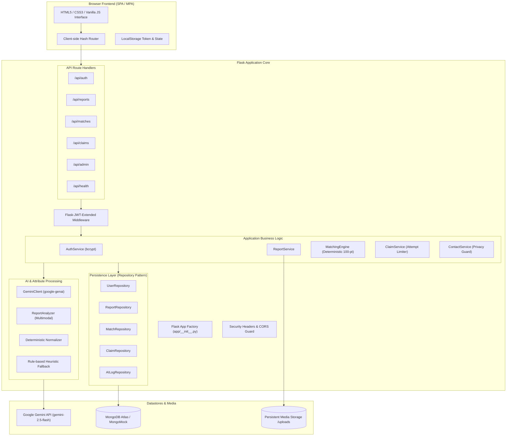

# SmartMatch — System Architecture & Technical Design

## 1. System Architecture Overview

SmartMatch is designed as a **Modular Monolith** adhering to strict separation of concerns between presentation, routing, application business logic, persistence, and external AI integrations.

---

## 2. Database Schema & Indexes

SmartMatch implements five core collections in the `smartmatch` database.

### 2.1 Collection: `users`
| Field | Type | Description |
|---|---|---|
| `_id` | ObjectId | Unique user identifier |
| `name` | String | Full user name |
| `email` | String | Case-insensitive unique institutional email |
| `password_hash` | String | Salted bcrypt hash |
| `role` | String | `student` or `admin` |
| `is_active` | Boolean | Account status |
| `created_at` | DateTime | Account creation timestamp |

**Indexes:**
- `{"email": 1}`, Unique: true
- `{"role": 1}`

### 2.2 Collection: `reports`
| Field | Type | Description |
|---|---|---|
| `_id` | ObjectId | Unique report identifier |
| `user_id` | ObjectId | Submitting user reference |
| `report_type` | String | `lost` or `found` |
| `title` | String | Item headline |
| `description` | String | User-provided text description |
| `category` | String | Canonical category (`electronics`, `personal_accessory`, etc.) |
| `location` | String | Campus incident location |
| `incident_date` | String | ISO formatted date (`YYYY-MM-DD`) |
| `image_path` | String | Relative URL path to uploaded photograph |
| `attributes` | Object | Normalized attribute dictionary (color, material, shape, brand, features) |
| `object_type` | String | Canonical object type (`wallet`, `water_bottle`, `backpack`, etc.) |
| `user_stated_details` | Array | Details explicitly mentioned in description text |
| `visually_observed_details` | Array | Details verified from photograph |
| `unknowns` | Array | Ambiguous, obscured, or undetermined attributes |
| `image_quality` | String | `high`, `adequate`, `poor`, `unreadable` |
| `ai_status` | String | `completed`, `failed`, `manual` |
| `extraction_version` | String | Schema extraction version |
| `status` | String | `active`, `claim_pending`, `under_review`, `resolved`, `inactive`, `closed` |
| `created_at` | DateTime | Timestamp |
| `updated_at` | DateTime | Timestamp |

**Indexes:**
- `{"report_type": 1}`
- `{"status": 1}`
- `{"user_id": 1}`
- `{"incident_date": -1}`
- `{"created_at": -1}`

### 2.3 Collection: `matches`
| Field | Type | Description |
|---|---|---|
| `_id` | ObjectId | Unique match pair record |
| `lost_report_id` | String | ID of lost report |
| `found_report_id` | String | ID of found report |
| `score` | Float | 0.0 to 100.0 deterministic score |
| `label` | String | `Strong candidate`, `Possible match`, `Low similarity` |
| `score_breakdown` | Object | Points allocated per attribute |
| `matched_attributes` | Array | Explanatory strings of matching characteristics |
| `conflicts` | Array | Explanatory strings of conflicting characteristics |
| `unknowns` | Array | Explanatory strings of neutral/missing characteristics |
| `algorithm_version`| String | Version string (e.g. `1.0.0`) |
| `config_version` | String | Config version string (e.g. `2026.1`) |
| `created_at` | DateTime | Timestamp |

**Indexes:**
- `{"lost_report_id": 1, "found_report_id": 1}`, Unique: true
- `{"score": -1}`

### 2.4 Collection: `claims`
| Field | Type | Description |
|---|---|---|
| `_id` | ObjectId | Unique claim identifier |
| `report_id` | String | Found item report reference |
| `claimant_id` | String | User ID of claimant |
| `verification_answers`| String | Private ownership evidence |
| `status` | String | `pending`, `approved`, `rejected`, `locked` |
| `attempt_count` | Integer | Counter (max 3 before lock) |
| `reviewed_by` | String | User ID of reviewing finder or admin |
| `reviewed_at` | DateTime | Review timestamp |
| `review_notes` | String | Optional notes |
| `created_at` | DateTime | Timestamp |

**Indexes:**
- `{"report_id": 1}`
- `{"claimant_id": 1}`
- `{"status": 1}`

### 2.5 Collection: `ai_logs`
| Field | Type | Description |
|---|---|---|
| `_id` | ObjectId | Unique audit record |
| `report_id` | String | Associated report ID |
| `model_name` | String | Gemini model string (`gemini-2.5-flash`) |
| `prompt_version` | String | Prompt template version |
| `extraction_version`| String | Schema version |
| `status` | String | `completed`, `failed`, `manual` |
| `error_type` | String | Exception class name if failed |
| `created_at` | DateTime | Timestamp |

---

## 3. Deterministic Matching Engine

The core product principle dictates that **Gemini must never decide final match rankings**. The matching algorithm is implemented in pure, predictable Python logic.

### 3.1 100-Point Scoring Matrix
| Attribute | Max Points | Evaluation Rules |
|---|---:|---|
| **Category** | 20 | Identical category: 20 pts. Generic 'other': 10 pts. Conflict: 0 pts. |
| **Object Type** | 15 | Identical object type: 15 pts. Partial/substring match: 10 pts. Generic 'item': 5.25 pts. Conflict: 0 pts. |
| **Brand / Logo** | 15 | Matching recognized brand: 15 pts. Both unbranded/unknown: 7.5 pts. Brand on one only: 7.5 pts. Distinct brands: 0 pts. |
| **Color** | 15 | Overlapping normalized colors: 15 pts. Both unknown: 7.5 pts. One unknown: 7.5 pts. Conflicting colors: 0 pts. |
| **Material & Shape**| 10 | Material overlap: 5 pts (unknown: 2.5 pts). Shape overlap: 5 pts (unknown: 2.5 pts). |
| **Distinctive Features**| 15 | Shared characteristic keywords (sticker, engraved, scratched, keychain, etc.): 15 pts. Neutral: 5-7.5 pts. |
| **Location Proximity**| 5 | Identical location text: 5 pts. Substring/zone overlap: 4 pts. Different campus zone: 2 pts. |
| **Date Proximity** | 5 | Same date: 5 pts. Within 2 days: 4.5 pts. Within 7 days: 3.5 pts. Within 14 days: 2 pts. >30 days: 0 pts. |
| **Total** | **100** | Clamped to range `[0.0, 100.0]`. |

### 3.2 Ranking Thresholds
- **Strong candidate:** Score $\ge 70.0$
- **Possible match:** $40.0 \le \text{Score} < 70.0$
- **Low similarity:** $\text{Score} < 40.0$

### 3.3 Deterministic Tie-Breaking Sequence
When reports have identical match scores, ordering is guaranteed deterministic by evaluating:
1. `score` descending.
2. `incident_date` proximity ascending (closest dates first).
3. `created_at` ascending.
4. Stable report `id` ascending.

---

## 4. Privacy & Contact Security Architecture

### 4.1 Contact Information Shield
- Public `GET /api/reports` and `GET /api/reports/<id>` return submitter name and display `submitter_email = "[PROTECTED — AVAILABLE UPON APPROVED CLAIM]"`.
- Real email addresses are strictly excluded from all public responses.

### 4.2 Authorized Handover Endpoint
- Endpoint: `GET /api/reports/<id>/contact`
- Requirements:
  1. Valid JWT token.
  2. Approved claim on the report must exist.
  3. Requester identity must match either the report's finder, the approved claimant, or an administrator.
  4. Returns direct contact details for both parties and recommended campus security handover instructions.
  5. Any other requester receives `403 Forbidden`.

### 4.3 Claim Verification Protection
- Claimants provide identifying evidence (e.g. engravings, internal pockets, passcodes).
- Private verification answers are only visible to the finder and campus administrators.
- Claim attempt limit: 3 attempts per claimant. Exceeding 3 failed attempts sets `status = locked`.
